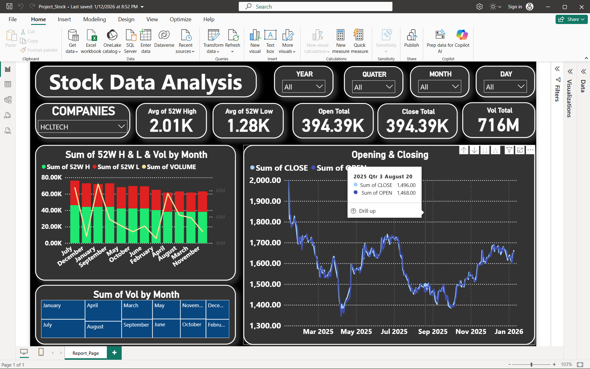

# Stock Data Analysis (Power BI)

A one-page Power BI dashboard for exploring NSE stock prices and trading activity across nine companies. The report combines company and date filters with price, 52-week range, and volume views.

The project owner says the original analysis was created on **23 March 2024**. The supplied CSV filenames indicate a **January 2025–January 2026** data window, so the included data appears to be a later snapshot than the original project build.

## About the Author

I'm **Nikhil Vishwakarma**, a Data Analyst, MIS Analyst, and Power BI Developer. My background includes a BCA in Data Science & Artificial Intelligence from Babu Banarasi Das University, Lucknow (2023–2026). I work with SQL, Python, Advanced Excel, and Power BI, with a focus on data cleaning, MIS reporting, and KPI dashboards.

## Dashboard preview



## What the dashboard shows

- **Filters:** company, year, quarter, month, and day.
- **KPI cards:** average 52-week high and low, total opening price, total closing price, and total volume.
- **Monthly range and volume:** 52-week high and low columns with volume by month.
- **Price trend:** opening and closing prices over time.
- **Monthly volume:** treemap view of volume by month.

The screenshot shows HCLTECH selected and the price trend from March 2025 through January 2026; values change when the report filters change.

## What's included

- `reports/Project_Stock.pbix` — Power BI report and its embedded model.
- `data/raw/stocks/` — nine ticker-level CSV files: AIRTELPP, HCLTECH, HDFCBANK, HINDUNILVR, ICICIBANK, INFY, ITC, RELIANCE, and SBIN.
- `data/reference/Main_Data_Stock.xlsx` — source workbook included in the archive.
- `docs/data-dictionary.md` — field descriptions and notes about the supplied data.
- `docs/images/stock-data-analysis-dashboard.png` — screenshot of the report page.

## Open the report

1. Install [Power BI Desktop](https://powerbi.microsoft.com/desktop/).
2. Open `reports/Project_Stock.pbix`.
3. If you refresh the report and Power BI asks for a source location, inspect **Transform data → Data source settings** and point the queries to the files in `data/raw/stocks/` or `data/reference/` as appropriate. Refresh behavior depends on the connections saved in the PBIX.

The archive does not include separate Power Query source files or connection documentation, so the saved report's refresh configuration should be reviewed in Power BI Desktop before relying on refresh from another machine.

## Repository layout

```text
.
├── data/
│   ├── raw/stocks/       # Original ticker CSVs
│   └── reference/        # Original Excel workbook
├── docs/
│   ├── data-dictionary.md
│   └── images/stock-data-analysis-dashboard.png
├── reports/
│   └── Project_Stock.pbix
├── .gitattributes
├── .gitignore
└── README.md
```

## Data provenance and license

The project owner identifies the market data as sourced from the **National Stock Exchange of India (NSE)**. The archive does not include the exact download URL, retrieval date, or redistribution terms. Confirm the applicable attribution and permission before publishing the data. No repository license has been added; choose one before allowing reuse of the project.

## GitHub upload

After creating an empty GitHub repository, connect it and push this project:

```powershell
git add .
git commit -m "Prepare stock market analysis project"
git remote add origin https://github.com/<username>/<repository>.git
git push -u origin main
```

Replace the remote URL with the new repository URL. The PBIX and workbook are included as regular files; the current versions are below GitHub's 100 MB per-file limit.
